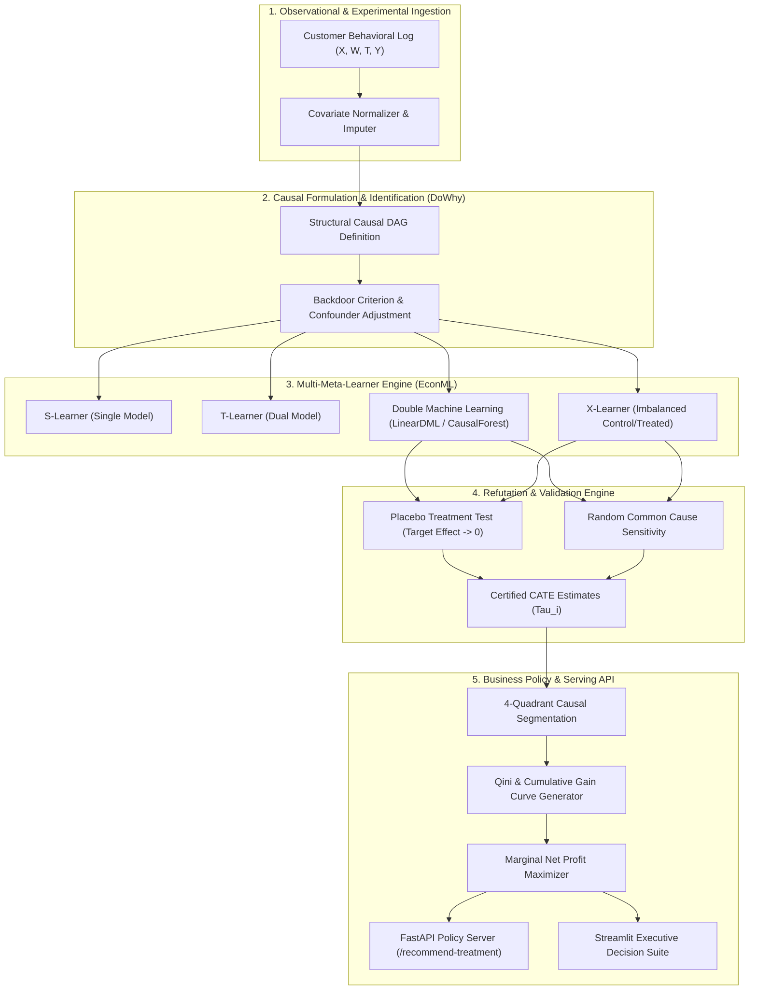

# System Architecture & Technical Specification
## CausalOptima-Engine: Causal Inference & Uplift Modeling Platform

---

### 1. High-Level Architecture Flowchart

---

### 2. The Four Causal Quadrants & Policy Matrix

In standard machine learning, users are bucketed simply by $P(\text{Buy})$. In **Causal Uplift**, customers are categorized across two parallel potential outcome universes: $Y_i(1)$ (Outcome if Treated) and $Y_i(0)$ (Outcome if Untreated):

| Causal Quadrant | $Y_i(0)$ (Untreated) | $Y_i(1)$ (Treated) | Individual Treatment Effect $\tau_i$ | Optimal Business Action |
| :--- | :---: | :---: | :---: | :--- |
| **Persuadables** | 0 (No purchase) | 1 (Purchases) | **+1 (Positive Uplift)** | **TARGET:** Send discount promo. Only buy if incentivized. |
| **Sure Things** | 1 (Purchases) | 1 (Purchases) | **0 (Zero Uplift)** | **DO NOT TARGET:** Will buy anyway; discounts destroy margin. |
| **Lost Causes** | 0 (No purchase) | 0 (No purchase) | **0 (Zero Uplift)** | **DO NOT TARGET:** Will never buy; marketing cost is wasted. |
| **Sleeping Dogs** | 1 (Purchases) | 0 (No purchase) | **-1 (Negative Uplift)** | **STRICT SUPPRESSION:** Irritated by outreach; marketing causes churn. |

---

### 3. Mathematical Foundations of Double Machine Learning (DML)
Standard regression of $Y$ on $T$ and $X$ using regularized ML (Lasso, XGBoost) yields biased treatment effect estimates due to regularized shrinkage bias.

**Chernozhukov et al. Double/Debiased Machine Learning (DML)** overcomes this through **orthogonal Neyman residuals**:
1. Train ML model $\hat{\mu}_0(X)$ to predict $Y$ from confounders $X$:
   $$\tilde{Y} = Y - \hat{\mu}_0(X)$$
2. Train ML model $\hat{m}_0(X)$ to predict propensity $T$ from confounders $X$:
   $$\tilde{T} = T - \hat{m}_0(X)$$
3. Regress the orthogonalized residual $\tilde{Y}$ on the residualized treatment $\tilde{T}$:
   $$\tilde{Y} = \tau(X) \cdot \tilde{T} + \epsilon \quad \mathbb{E}[\epsilon \cdot \tilde{T}] = 0$$
This eliminates first-stage estimation errors, providing **root-$N$ consistent, asymptotic normal estimates** of the causal parameter $\tau(X)$.

---

### 4. Technical Stack Manifest

| Component | Technology | Rationale |
| :--- | :--- | :--- |
| **Causal Identification** | DoWhy (PyWhy ecosystem) | Robust graph-based structural causal models and automated refutation algorithms. |
| **Uplift & CATE Estimation** | Microsoft EconML | Enterprise-grade implementation of DML, Causal Forests, and Meta-Learners. |
| **Machine Learning Backbones** | LightGBM + Scikit-Learn | Fast gradient boosted estimators for first-stage residual regressions. |
| **Data Engine & Metrics** | Polars + DuckDB | High-performance columnar calculations for Qini and cumulative gain curves. |
| **Serving API** | FastAPI + Pydantic v2 | Microsecond personalized treatment policy assignment. |
| **Stakeholder Dashboard** | Streamlit + Plotly | Interactive visualizer for marketing spend simulation and DAG inspection. |
