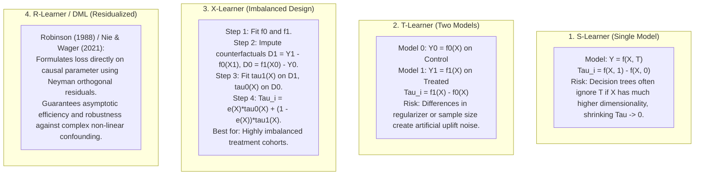

# Theoretical Foundations: Causal Inference, Uplift Modeling & Econometrics
## CausalOptima-Engine Technical Deep Dive

---

### 1. The Fundamental Problem of Causal Inference (Holland, 1986)
For any individual customer $i$, we observe only one realized factual outcome:
$$Y_i = T_i \cdot Y_i(1) + (1 - T_i) \cdot Y_i(0)$$
We cannot simultaneously observe customer $i$ receiving the discount and not receiving the discount at time $t$. The counterfactual outcome is permanently missing.

Predictive machine learning circumvents this by modeling the conditional expectation:
$$\mathbb{E}[Y | T=1, X] - \mathbb{E}[Y | T=0, X]$$
However, in observational data, this quantity suffers from **selection bias**:
$$\mathbb{E}[Y | T=1, X] - \mathbb{E}[Y | T=0, X] = \underbrace{\tau(X)}_{\text{True Causal Uplift}} + \underbrace{\mathbb{E}[Y(0) | T=1, X] - \mathbb{E}[Y(0) | T=0, X]}_{\text{Confounding Selection Bias}}$$

If marketing teams preferentially send coupons to active spenders, $\mathbb{E}[Y(0) | T=1] > \mathbb{E}[Y(0) | T=0]$, artificially inflating perceived campaign success.

---

### 2. Meta-Learner Taxonomy: S, T, X, and R-Learners

---

### 3. Business Incrementality & The Qini Curve
The standard Receiver Operating Characteristic (ROC-AUC) curve is useless for uplift because ground truth labels ($Y_i(1) - Y_i(0)$) cannot be observed per individual.

Instead, the **Qini Curve** evaluates policy performance across ranked percentiles $n$:

$$Q(n) = R_T(n) - R_C(n) \cdot \frac{N_T(n)}{N_C(n)}$$
Where:
- $R_T(n)$: Cumulative outcome of treated users in the top $n$ percentile.
- $R_C(n)$: Cumulative outcome of control users in the top $n$ percentile.
- $N_T(n), N_C(n)$: Counts of treated and control users in the top $n$ percentile.

A model with high **Qini Score / AUUC** successfully prioritizes users whose incremental revenue is steepest, allowing the marketing team to target the top 20% of users while capturing 90% of the possible incremental lift.
