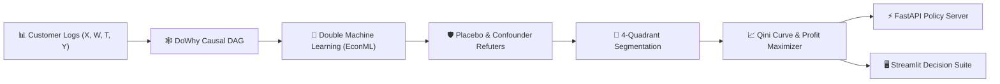

# 🎯 CausalOptima-Engine: Algorithmic Causal AI & Uplift Decision Platform
> **Stop Subsidizing Sure Things.** Transitioning from Predictive Correlation to Causal Incrementality with Microsoft EconML, DoWhy, Double Machine Learning (DML), and Qini Profit Optimization.

[](https://www.python.org/downloads/)
[](https://github.com/py-why/EconML)
[](https://github.com/py-why/dowhy)
[](https://fastapi.tiangolo.com)
[](https://streamlit.io)

---

## 🎯 Executive Overview
Standard machine learning predicts correlation: *"Who will buy?"* or *"Who will churn?"*. When companies blast promotions based purely on high propensity, they burn millions subsidizing **Sure Things** (who would buy anyway) while ignoring or angering **Sleeping Dogs** (who churn because of outreach).

**CausalOptima-Engine** solves the fundamental problem of causal inference:
1. **Structural Causal Identification (DoWhy):** Formulates explicit DAGs, eliminates unobserved confounding via backdoor adjustments, and audits fragility with Placebo refuters.
2. **Double Machine Learning (EconML):** Employs Neyman orthogonalized residuals to estimate true Individual Treatment Effects ($\tau_i$) without regularization bias.
3. **4-Quadrant Causal Segmentation:** Isolates **Persuadables** from **Sure Things**, **Lost Causes**, and **Sleeping Dogs**.
4. **Qini Curve & Profit Optimization:** Optimizes promotion thresholds to maximize net incremental gross margin per marketing dollar spent.

---

## 🏗️ Architecture & Component Topology



---

## 🚀 Quickstart & Setup

```bash
# 1. Clone & Enter Directory
cd Causal_AI_Uplift_Decision

# 2. Setup Virtual Environment with uv
uv venv
source .venv/bin/activate  # On Windows: .venv\Scripts\activate

# 3. Install Dependencies
uv pip install -e ".[dev]"

# 4. Generate Semi-Synthetic Causal Benchmark Data
python -m src.data.generator

# 5. Start Decision Recommendation API
uvicorn src.api.main:app --reload --port 8000

# 6. Launch Executive Decision Suite
streamlit run src/dashboard/app.py
```

---

## 📚 Technical Documentation & Blueprints
- [PRD.md](PRD.md): Product Requirements, user personas, and target SLAs.
- [ARCHITECTURE.md](ARCHITECTURE.md): Mathematical formulations of DML, orthogonal residuals, and Qini curves.
- [IMPLEMENTATION_PLAN.md](IMPLEMENTATION_PLAN.md): 6-phase milestone implementation roadmap.
- [CAUSAL_INFERENCE_AND_ECONOMETRIC_THEORY.md](CAUSAL_INFERENCE_AND_ECONOMETRIC_THEORY.md): Deep-dive into S/T/X/R Meta-Learners and the fundamental problem of causal inference.
- [DECISION_SCIENCE_AND_ROI_AUDIT.md](DECISION_SCIENCE_AND_ROI_AUDIT.md): Business incrementality, campaign ROI formulas, and refuter standards.
- [DECISIONS.md](DECISIONS.md): Architectural Decision Records (ADRs).
- [TASKS.md](TASKS.md): Live task backlog and implementation tracker.
